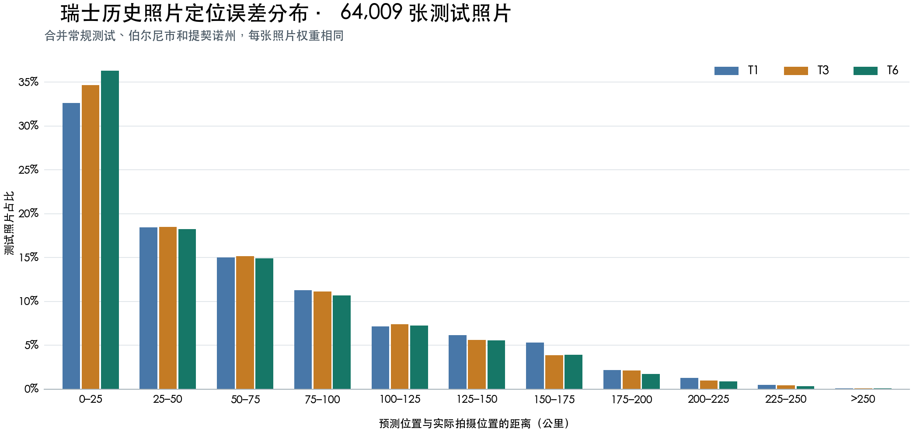

# 瑞士历史照片定位的本地实验

[复现步骤](../../../doc/local_experiment_reproduction.md)给出从原始输入到各模型评估的命令。[文件清单与校验方法](manifests/README.md)可用于在 DHLAB 或另一台实验机核对数据和检查点。

这组实验比较了真实训练照片、扩散增强、位置重排和逐照片模型选择。T1 在地理网格中检索，T3 按视觉和年份检索真实训练照片，T4 直接回归坐标，T5 用位置匹配分重排 T3 的前 50 个视觉候选。下表及原始精度总表中的 T6 为第一版，选用 25 公里命中概率较高的专家。当前 T6 由训练好的选择器根据两组预测坐标及其置信度决定采用 T4 或 T5。

[模型精度总表](model_accuracy.csv) 按模型和测试区提供样本数、误差中位数、均值、第 90 百分位，以及 1、5、25、50 公里的命中数与百分比。总表使用加入 8,192 张增强图的各模型，对同一批 64,009 张真实测试照片按 ID 配对。三组样本量分别为普通留出块 47,593 张、伯尔尼市 3,377 张和提契诺州 13,039 张。

| 25 公里命中率 | T1 | T3 | T4 | T5 | T6 |
| --- | ---: | ---: | ---: | ---: | ---: |
| 普通留出块 | 42.44% | 45.38% | 21.12% | 48.219% | 48.223% |
| 伯尔尼市 | 8.53% | 5.48% | 9.98% | 6.96% | 6.72% |
| 提契诺州 | 2.89% | 3.12% | 20.65% | 2.97% | 2.97% |

T6 v1 在普通留出块救回 T5 错过的 36 张照片，也丢失了 T5 已命中的 34 张。提契诺有 2,509 张照片只有 T4 能命中，v1 把它们全部交给了 T5。[逐区选择统计](t6/routing.csv)

## 当前 T6 与 T1、T3 的测试误差

对相同的 64,009 张真实测试照片按张汇总，误差中位数分别为 T1 的 48.29 公里、T3 的 44.71 公里和 T6 v2 的 42.69 公里。三者的 25 公里命中率分别为 32.59%、34.67% 和 36.29%。T6 v2 比 T3 净多命中 1,034 张，其中常规测试多 1,036 张，伯尔尼多 14 张，提契诺少 16 张。相同口径下，T6 v1 总共命中 23,565 张，v2 命中 23,226 张。[逐区统计与分箱计数](t6/heldout_histogram.json)

## 结果索引与来源

下表的 `RUNS` 表示项目内的 `data/local_runs`，`DATA_ROOT` 表示项目外保存扩散数据和训练产物的数据根目录。JSON 中的原始输入指纹可用于配对同一次实验的产物。文件路径采用仓库相对路径或以 `DATA_ROOT/` 开头的数据路径。存档保留原始指标单位，CSV 中带 `_pct` 的列是百分比；置信度指标中的 `hit_rate`、`mean_probability` 为 0 到 1 的比例。

| 内容 | 本归档文件 | 原实验位置 |
| --- | --- | --- |
| T1 真实数据本地与远端复跑、合成输入速度估计 | [真实复跑](t1/local_vs_remote.json)、[合成速度基准](t1/synthetic_speed_benchmark.json) | `RUNS/t1_full_20261122T111311_449581Z/comparison.json`、`RUNS/t1_speed_20261122_012033/benchmark.json` |
| T1 加入 8,192 张扩散图与原始训练对比 | [T1 增强结果](t1/augmentation_8192.json)、[生成统计](augmentation/generation_8192.json) | `DATA_ROOT/aug8192/t1_runs/aug_20261122T140802_053796Z/comparison.json`、`DATA_ROOT/aug8192/generation_summary.json` |
| 同组增强条件下 T1、T3、T4 的比较 | [模型对比](augmentation/model_comparison.json) | `RUNS/t3_t4_8192/comparison.json` |
| T3 候选覆盖、训练照片密度和坐标微调 | [前 50 名覆盖](t3/top50.json)、[密度](t3/density.json)、[位置微调](t3/refinement.json) | `RUNS/t3_refine_analysis/` 下的 `top50_aug.json`、`density.json`、`refinement.json` |
| T4 原始与增强配对、增强规模曲线 | [配对比较](t4/paired.json)、[增强规模](t4/augmentation_curve.json) | `RUNS/t3_t4_8192/t4_comparison.json`、`RUNS/t3_t4_8192/t4_augmentation_curve.json` |
| T4 两组各 4,096 张，按随机或地理稀疏度选原图 | [采样方案](t4_geo4096/protocol.json)、[分区统计](t4_geo4096/comparison.json)、[误差分布](t4_geo4096/error_distribution.json)、[分布图](t4_geo4096/error_distribution.png) | `RUNS/t4_geo4096/` 下的同名文件 |
| T5 重排权重验证曲线与按照片配对的比较 | [验证](t5/validation.json)、[运行记录](t5/run.json)、[T5 对 T3 和 T1](t5/comparison.json)、[四模型精度图](t5/model_accuracy.png) | JSON 来自 `RUNS/t5_aug8192/results/`，图来自 `RUNS/t5_aug8192/model_accuracy.png` |
| 四个定位器各自估计 25 公里内命中概率 | [分区校准指标](confidence/metrics.csv)、[地理块划分与概率分箱](confidence/comparison.json) | `RUNS/confidence_models/` 下的同名文件 |
| T6 选择效果及训练照片距离分层 | [所有阈值](t6/metrics.csv)、[选择得失](t6/routing.csv)、[配对差异与区间](t6/comparison.json)、[距离与置信度分层](t6/proximity.json) | `RUNS/t6_aug8192/` 下的同名文件 |
| 五模型统一口径的精度总表 | [模型精度 CSV](model_accuracy.csv) | 从 `RUNS/confidence_models/predictions.parquet` 和 `RUNS/t6_aug8192/predictions.parquet` 的 `error_km` 分组汇总 |

各模型运行方式与输入见 [T5 说明](../../../models/t5_reranker/README.md)、[T6 说明](../../../models/t6_router/README.md) 和[置信度库说明](../../../doc/geolocation_confidence.md)。
